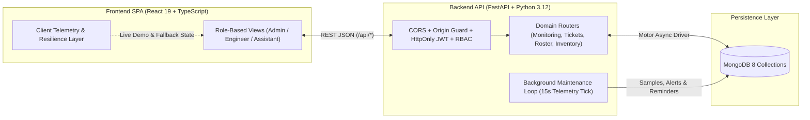

# Atlas NetCare

**Campus Network Operations & Lab Asset Management Platform**  
*Final Year Project — Diploma in Information Technology*  
*Asia Pacific University of Technology & Innovation (APU)*

---

## Executive Summary

**Atlas NetCare** is a full-stack web application designed to centralize campus IT operations across computer laboratories, academic blocks, and shared wireless zones. In many academic institutions, wireless access-point monitoring, physical lab workstation inspections, incident ticketing, hardware asset tracking, and student/staff assistant shift handovers are managed across disconnected spreadsheets and standalone tools.

Atlas NetCare unifies these workflows into a single role-based operational portal tailored for three distinct operational roles—**Administrator**, **Network Engineer**, and **IT Assistant**—providing real-time visibility from fault detection to resolution and audit compliance.

> **Academic Demonstration Scope:**  
> Network telemetry, remote ping/PoE diagnostics, radio remediation, and password-recovery notices are **simulated** so examiners and evaluators can safely trigger, inspect, and resolve realistic campus network faults during a live demonstration without connecting to physical university switches or wireless controllers. All operational records—users, sessions, campus locations, hardware assets, checklists, incident tickets, duty shifts, and audit logs—are persisted in **MongoDB**.

---

## Table of Contents

1. [Project Objectives](#project-objectives)
2. [System Architecture](#system-architecture)
3. [Key Features & Modules](#key-features--modules)
4. [Role-Based Access Control (RBAC)](#role-based-access-control-rbac)
5. [Technology Stack](#technology-stack)
6. [Getting Started](#getting-started)
7. [Default Demonstration Accounts](#default-demonstration-accounts)
8. [Environment Configuration](#environment-configuration)
9. [Core Business & Domain Rules](#core-business--domain-rules)
10. [REST API Overview](#rest-api-overview)
11. [Project Structure](#project-structure)
12. [Testing, Code Quality & CI](#testing-code-quality--ci)
13. [Known Limitations & Future Enhancements](#known-limitations--future-enhancements)
14. [Troubleshooting](#troubleshooting)

---

## Project Objectives

1. **Centralize Campus IT Operations:** Replace fragmented manual logs with an integrated platform covering wireless monitoring, lab equipment checklists, incident management, and staff shift scheduling.
2. **Enforce Structured Escalation & Accountability:** Automate fault-to-ticket creation, deduplicate repeated incident reports on the same device, route faults between **Tier 1 (Lab Hardware)** and **Tier 2 (Network Infrastructure)**, and record an immutable activity audit log.
3. **Streamline Physical Lab Readiness:** Enable IT Assistants on shift duty to perform standardized five-point workstation inspections, visualize room readiness, and log structured shift handover notes.
4. **Support Interactive Fault Simulation for Evaluation:** Provide deterministic fault-injection scenarios (bandwidth congestion, PoE/hardware outage, telemetry feed interruption, link flapping) alongside diagnostic and remediation workflows.
5. **Deliver a Responsive, Accessible User Interface:** Provide a clean, mobile- and desktop-responsive interface supporting both **Dark Mode** and **Light Mode**, plus one-click **CSV** and printable **PDF** operational reports.

---

## System Architecture



### Operational Workflow Lifecycle

1. **Shift Duty & Lab Inspection:** An **IT Assistant** acknowledges their assigned lab shift (`/shifts`) and completes five-point workstation checklists (`/checklists`). Any failed hardware or connectivity check automatically opens—or attaches to—an active incident ticket.
2. **Wireless Telemetry & Anomaly Detection:** The background maintenance engine samples 28 campus access points (`/monitoring`), distinguishing between **Online**, **Congested**, **Offline**, and **Feed Interrupted (Stale)** states and raising in-app fleet alerts.
3. **Triage, Diagnostics & Remediation:** A **Network Engineer** investigates anomalies via simulated ICMP/PoE/5GHz diagnostics, executes remote recovery actions (PoE port reboot, 5GHz channel rebalance, SNMP agent restart), and progresses Tier 2 tickets from **Open → In Progress → Resolved**.
4. **Governance & SLA Reporting:** An **Administrator** manages campus locations, DHCP/VLAN hardware inventory, user accounts, and duty rosters while tracking Mean Time to Resolution (MTTR) and compliance metrics via exportable **CSV** and **PDF** reports (`/reports`, `/audit`).

---

## Key Features & Modules

| Module | Route | Description |
|---|---|---|
| **Role-Tailored Dashboard** | `/` | Personalized KPI cards, live health indicators, active incident queues, shift summaries, and instant CSV/PDF snapshot exports tailored to the signed-in role. |
| **Wireless Network Monitoring** | `/monitoring` | Real-time and historical (24h) bandwidth/client telemetry across 28 campus APs, responsive status filter pills, auto-sampling controls, fault simulation, ping/PoE diagnostics, and one-click Tier 2 ticket escalation. |
| **Equipment Checklists** | `/checklists` | Five-point workstation verification (*Power & Boot*, *Display*, *Keyboard & Mouse*, *Network Connectivity*, *OS & Lab Software*), interactive 2D lab workstation map, batch lab verification, and automatic fault ticketing. |
| **Incident Tickets** | `/tickets` | End-to-end fault tracking with automated Tier 1 / Tier 2 classification, priority elevation for network outages, status workflow enforcement, resolution verification notes, and timestamped activity history. |
| **Shift Schedule & Handover** | `/shifts` | Duty roster scheduled in Malaysia Time (`Asia/Kuala_Lumpur`, UTC+8) with overlap detection, shift acknowledgement, structured handover logs, and role-isolated notification bell reminders. |
| **Hardware Inventory (ITAM)** | `/assets` | Lifecycle management for campus Access Points and Lab Workstations with automated room-based asset tagging, VLAN assignment, DHCP IP reservation preview, and archive/restore controls. |
| **Campus Locations** | `/locations` | Directory of 11 campus zones across computing labs, lecture halls, library, canteen, and outdoor areas with live assigned-device counts. |
| **Team & Access Management** | `/users` | Account provisioning, role assignment (`admin`, `engineer`, `assistant`), password resets, and account activation/deactivation safeguards. |
| **Operational SLA Reports** | `/reports` | Time-windowed (`Today`, `Last 7 Days`, `Last 30 Days`) analytics on fleet availability, checklist pass rates, incident volume, and measured MTTR with CSV and printable PDF export. |
| **Activity Audit Log** | `/audit` | Searchable, chronological audit trail of up to 1,000 administrative and operational actions with CSV and PDF export for compliance review. |

---

## Role-Based Access Control (RBAC)

Atlas NetCare enforces role isolation across both frontend navigation routes and backend FastAPI permission dependencies:

| Capability | IT Assistant | Network Engineer | Administrator |
|---|:---:|:---:|:---:|
| Role-specific operational dashboard (`/`) | Yes | Yes | Yes |
| Acknowledge shifts & submit handover notes (`/shifts`) | Yes | No | Yes |
| Assign or cancel staff shifts (`/shifts`) | No | No | Yes |
| Submit & batch-verify workstation checklists (`/checklists`) | Yes | No | View Only |
| Report hardware or network incidents (`/tickets`) | Yes | Yes | Yes |
| Triage, start work & resolve incident tickets (`/tickets`) | No | Yes | Yes |
| Access wireless telemetry, diagnostics & remediation (`/monitoring`) | No | Yes | Yes |
| Trigger & reset network fault simulations (`/monitoring`) | No | Yes | Yes |
| Manage hardware inventory & campus locations (`/assets`, `/locations`) | No | No | Yes |
| Manage user accounts & role permissions (`/users`) | No | No | Yes |
| View & export SLA reports and activity audit logs (`/reports`, `/audit`) | No | No | Yes |

---

## Technology Stack

| Layer | Technologies Used |
|---|---|
| **Frontend** | React 19, TypeScript 5.9, React Router 7, Tailwind CSS 3.4, Radix UI Primitives, Recharts 3, Lucide Icons, Axios, CRACO |
| **Backend** | Python 3.12, FastAPI, Uvicorn, Motor (AsyncIO MongoDB Driver), Pydantic v2 |
| **Database** | MongoDB 8 (isolated `_atlas_demo` database namespace in demonstration mode) |
| **Authentication & Security** | `bcrypt` password hashing, PyJWT (`HS256` access & refresh tokens in `HttpOnly` cookies), strict CORS & `Origin` verification, custom `X-Atlas-Request` CSRF header guard |
| **Testing & Quality Assurance** | `pytest`, `pytest-asyncio`, `mongomock-motor` (57 automated backend tests), `flake8`, `black`, TypeScript (`tsc --noEmit --noUnusedLocals`), Prettier, GitHub Actions CI |

---

## Getting Started

### Prerequisites

Ensure the following tools are installed on your machine:

- **Python** `3.12` (or `3.13`)
- **Node.js** `24.x` (or `20+` LTS) and **npm**
- **MongoDB** `8.x` running locally on `mongodb://127.0.0.1:27017` (or a reachable MongoDB URI)

---

### 1. Backend Setup

1. Navigate to the `backend` directory, create a virtual environment, and install dependencies:

   ```bash
   cd backend
   python3.12 -m venv .venv
   .venv/bin/pip install -r requirements.txt
   ```
   *(On Windows PowerShell/CMD, use `.venv\Scripts\pip install -r requirements.txt`.)*

2. Create a `backend/.env` file with the following configuration:

   ```dotenv
   MONGO_URL=mongodb://127.0.0.1:27017
   DB_NAME=netcare
   DEMO_MODE=true
   JWT_SECRET=replace-with-a-secure-random-secret-at-least-32-characters
   WEBHOOK_CRON_SECRET=replace-with-a-webhook-maintenance-secret
   ADMIN_EMAIL=owner@apu.edu.my
   ADMIN_PASSWORD=OwnerSecure2026!
   DEMO_PASSWORD=AtlasDemo2026!
   FRONTEND_URL=http://localhost:3000
   CAMPUS_TIMEZONE=Asia/Kuala_Lumpur
   ```

3. Start the FastAPI server on port `8001`:

   ```bash
   .venv/bin/uvicorn server:app --host 0.0.0.0 --port 8001 --reload
   ```

   On initial startup, the backend automatically seeds MongoDB with default accounts, **11 campus locations**, **28 wireless access points**, **30 lab workstations**, sample incident tickets, active shifts, and **24 hours of historical telemetry**. Subsequent restarts preserve existing data.

   - **Health Check:** `http://localhost:8001/api/health`
   - **Interactive OpenAPI / Swagger UI:** `http://localhost:8001/docs`

---

### 2. Frontend Setup

1. Open a new terminal, navigate to `frontend`, and install packages:

   ```bash
   cd frontend
   npm install --legacy-peer-deps
   ```
   > **Note:** `--legacy-peer-deps` is required because `react-scripts` 5 specifies TypeScript `^3 || ^4` as an optional peer dependency while this project uses TypeScript `5.9` for stricter type safety.

2. Create a `frontend/.env` file:

   ```dotenv
   REACT_APP_BACKEND_URL=http://localhost:8001
   PORT=3000
   ```

3. Launch the development server:

   ```bash
   npm start
   ```

4. Open `http://localhost:3000` in your browser and sign in using any of the [Default Demonstration Accounts](#default-demonstration-accounts) below.

---

### 3. Resetting Demonstration Data (Optional)

To wipe and re-seed the demonstration database back to a clean baseline before a presentation or viva:

```bash
cd backend
.venv/bin/python reset_demo.py --confirm RESET-ATLAS-DEMO
```

As a safety mechanism, `reset_demo.py` refuses to execute unless `DEMO_MODE=true` and the resolved database name ends with `_atlas_demo`.

---

## Default Demonstration Accounts

All seeded accounts share the password configured in `DEMO_PASSWORD` (**`AtlasDemo2026!`** using the sample `.env` above):

| Role | Email Address | Password | Full Name | Primary Evaluation Focus |
|---|---|---|---|---|
| **Administrator** | `admin@apu.edu.my` | `AtlasDemo2026!` | Alex Morgan | Full portal access, inventory, locations, roster, team management, SLA reports & audit log |
| **Network Engineer** | `engineer@apu.edu.my` | `AtlasDemo2026!` | Daniel Reyes | AP telemetry monitoring, fault simulation, remote diagnostics/remediation & Tier 2 tickets |
| **IT Assistant** | `assistant@apu.edu.my` | `AtlasDemo2026!` | Jamie Santos | Shift acknowledgement, handover notes, 2D lab map & workstation inspection checklists |

Additional seeded staff accounts for multi-user roster and ticket assignment testing:

| Role | Email Address | Full Name |
|---|---|---|
| Network Engineer | `sofia@apu.edu.my` | Sofia Cruz |
| IT Assistant | `mika@apu.edu.my` | Mika Flores |
| IT Assistant | `leo@apu.edu.my` | Leo Garcia |
| IT Assistant | `nina@apu.edu.my` | Nina Ramos |
| IT Assistant | `kai@apu.edu.my` | Kai Mendoza |
| Owner Administrator | Value of `ADMIN_EMAIL` | Uses `ADMIN_PASSWORD` from `backend/.env` |

> **Data Privacy Notice:** Use fictional names and emails only during testing. Do not enter real student or staff personal data.

---

## Environment Configuration

### Backend (`backend/.env`)

| Variable | Required | Description |
|---|:---:|---|
| `MONGO_URL` | Yes | MongoDB connection URI (e.g., `mongodb://127.0.0.1:27017`). |
| `DB_NAME` | Yes | Base database name. Resolves to `<DB_NAME>_atlas_demo` when `DEMO_MODE=true` or `<DB_NAME>_atlas` otherwise to prevent accidental data mixing. |
| `DEMO_MODE` | Yes | Enables demonstration seeding, reset safeguards, and simulated recovery flows (`true` recommended for academic evaluation). |
| `JWT_SECRET` | Yes | Secret key (minimum 32 random bytes recommended) used to sign `HS256` access and refresh tokens. |
| `WEBHOOK_CRON_SECRET` | Yes | Bearer token authenticating external calls to `POST /api/cron/maintain`. |
| `ADMIN_EMAIL` | Yes | Email address for the protected owner administrator account. |
| `ADMIN_PASSWORD` | Yes | Password for the owner administrator account. |
| `DEMO_PASSWORD` | Yes | Default password assigned to all seeded campus demonstration accounts. |
| `FRONTEND_URL` | Yes | Exact browser origin allowed by CORS and the mutating-request origin guard (e.g., `http://localhost:3000`). |
| `CAMPUS_TIMEZONE` | No | IANA timezone for shift scheduling and timestamps (defaults to `Asia/Kuala_Lumpur`). |
| `PREVIEW_PROXY_ORIGIN` | No | Optional secondary allowed browser origin for preview tunnels or reverse proxies. |

### Frontend (`frontend/.env`)

| Variable | Required | Description |
|---|:---:|---|
| `REACT_APP_BACKEND_URL` | Yes | Base URL of the FastAPI server (e.g., `http://localhost:8001`). Restart `npm start` after modifying. |
| `PORT` | No | Local development port (defaults to `3000`; must match `FRONTEND_URL`). |

---

## Core Business & Domain Rules

- **Idempotent Workstation Checklists:** All five inspection items are mandatory and restricted to workstation (`PC`) assets. Every submission carries a client-generated `request_id`; retrying with the same key safely returns the existing record without creating duplicates, while reusing a key with altered payload data is rejected (`409`).
- **Automatic Incident Deduplication & Tier Routing:** Failed checklist items and manual fault reports check for an existing unresolved ticket on the same asset and append to its timeline rather than creating duplicate tickets. Network and Access Point issues automatically route to **Tier 2** and elevate `medium` priority reports to `high`.
- **Strict Ticket Lifecycle:** Tickets must transition through **Open → In Progress → Resolved**. Resolving a ticket requires resolution notes of at least 10 characters, and resolved tickets are locked against further status regressions.
- **Timezone-Aware Shift Validation:** Shift windows operate in Malaysia Time (`UTC+8`), are capped at 24 hours, and reject overlapping assignments for the same assistant (including cross-midnight shifts). Completed shifts preserve their original handover record and cannot be cancelled.
- **Honest Telemetry Classification:** Access points whose telemetry feed is interrupted or older than 20 minutes are surfaced distinctly as **Feed Interrupted (`stale`)** rather than falsely reporting a confirmed hardware outage (`offline`). Telemetry history is retained for 7 days (capped at 20,000 samples).
- **Side-Effect-Free Reads & Background Maintenance:** `GET` endpoints never mutate database state. Instead, an asynchronous background maintenance loop runs every 15 seconds to record AP telemetry samples, open/resolve threshold alerts, and generate shift reminders (with an idempotent `POST /api/cron/maintain` webhook available for serverless deployments).

---

## REST API Overview

All API endpoints are prefixed with `/api`. State-changing requests (`POST`, `PATCH`, `PUT`, `DELETE`) require an allowed `Origin` header and `X-Atlas-Request: 1` (attached automatically by the frontend Axios client).

| Domain | Endpoints |
|---|---|
| **Authentication** | `POST /auth/login`, `POST /auth/logout`, `POST /auth/refresh`, `GET /auth/me`, `PATCH /auth/profile`, `POST /auth/forgot-password`, `POST /auth/demo` |
| **Locations & Inventory** | `GET /labs`, `GET /locations`, `POST /locations`, `PATCH /locations/{id}`, `DELETE /locations/{id}`, `GET /assets`, `POST /assets`, `PATCH /assets/{id}`, `PATCH /assets/{id}/archive`, `DELETE /assets/{id}` |
| **Team Accounts** | `GET /users`, `POST /users`, `PATCH /users/{id}`, `DELETE /users/{id}` |
| **Shift Roster** | `GET /shifts`, `POST /shifts`, `POST /shifts/{id}/acknowledge`, `POST /shifts/{id}/complete`, `POST /shifts/{id}/cancel` |
| **Checklists & Tickets** | `GET /checklists`, `POST /checklists`, `POST /checklists/batch`, `GET /checklists/{id}`, `POST /incidents`, `GET /tickets`, `GET /tickets/{id}`, `PATCH /tickets/{id}`, `POST /tickets/{id}/comment` |
| **Network Monitoring** | `GET /monitoring`, `GET /monitoring/{id}/history`, `POST /monitoring/sample`, `POST /monitoring/{id}/diagnose`, `POST /monitoring/{id}/remediate`, `POST /simulation`, `GET /alerts` |
| **Reporting & System** | `GET /overview`, `GET /reports`, `GET /audit`, `POST /cron/maintain`, `GET /health` |

Example `curl` authentication request:

```bash
curl -X POST http://localhost:8001/api/auth/login \
  -H "Content-Type: application/json" \
  -H "X-Atlas-Request: 1" \
  -H "Origin: http://localhost:3000" \
  -d '{"email":"admin@apu.edu.my","password":"AtlasDemo2026!"}'
```

---

## Project Structure

```text
netcare-lab/
├── backend/
│   ├── server.py              # FastAPI app entry point, CORS, origin/CSRF guard & background loop
│   ├── core.py                # Environment settings, Motor client, RBAC helpers, leases & indexes
│   ├── auth.py                # JWT cookie sessions, login/logout, token refresh & profile updates
│   ├── campus.py              # Campus zone catalogue, VLAN mapping, DHCP IP allocator & tag generator
│   ├── inventory.py           # Campus locations & hardware asset CRUD / archive endpoints
│   ├── team.py                # User account management, role assignment & password administration
│   ├── roster.py              # Shift scheduling, overlap validation, acknowledgement & handovers
│   ├── tickets.py             # Workstation checklists, batch verification & incident ticket lifecycle
│   ├── monitoring.py          # Synthetic AP telemetry engine, fault simulation, alerts & remediation
│   ├── reporting.py           # Dashboard overview, SLA reports, activity audit log & cron webhook
│   ├── seed.py                # Idempotent startup seeding & schema migrations
│   ├── reset_demo.py          # Guarded CLI utility to wipe and re-seed demo data
│   ├── requirements.txt       # Production Python dependencies
│   └── requirements-dev.txt   # Testing & linting dependencies (pytest, mongomock-motor, flake8, black)
├── frontend/
│   ├── src/
│   │   ├── pages/             # Route views: Login, Dashboard, Monitoring, Checklists, Tickets,
│   │   │                      # Shifts, Assets, Locations, Team, Reports, Audit, Alerts
│   │   ├── components/        # Global Layout (sidebar, navbar, notifications), Telemetry charts/tables,
│   │   │                      # UserProfileModal, shared UI primitives
│   │   ├── lib/
│   │   │   ├── api.ts         # Axios client with automatic token refresh & MYT date formatters
│   │   │   ├── types.ts       # Strict TypeScript interfaces for API payloads
│   │   │   ├── workflow.ts    # Client-side demo state synchronization & local fallback helpers
│   │   │   ├── fleetSimulation.ts # Deterministic AP metric stepping & scenario builders
│   │   │   └── csv.ts         # RFC-compliant CSV export generator
│   │   ├── context.tsx        # React authentication & session state provider
│   │   ├── App.tsx            # Theme provider & role-protected routing table
│   │   ├── index.css          # Tailwind base layers & light/dark theme CSS custom properties
│   │   └── App.css            # Enterprise component, table, modal & responsive layout styles
│   ├── tailwind.config.js     # Tailwind CSS theme configuration
│   └── package.json           # Frontend scripts (start, build, typecheck, format)
├── tests/                     # Automated pytest suite (API integration, architecture & simulation tests)
└── .github/workflows/ci.yml   # GitHub Actions CI pipeline for backend & frontend verification
```

---

## Testing, Code Quality & CI

### Backend Test Suite & Linters

The backend test suite uses `mongomock-motor` (an in-memory async MongoDB mock), so all **57 automated tests** run without requiring a live MongoDB instance or `.env` file:

```bash
python3.12 -m venv backend/.venv
backend/.venv/bin/pip install -r backend/requirements-dev.txt

# Run automated test suite from repository root
backend/.venv/bin/pytest

# Run code style & lint checks
backend/.venv/bin/flake8 backend tests
backend/.venv/bin/black --check backend tests
```

- **`tests/test_api.py`, `test_api_admin.py`, `test_api_ops.py`:** End-to-end HTTP integration tests covering authentication, role-based access denials, idempotent checklists, ticket lifecycle rules, shift overlap validation, inventory CRUD, fault simulation, SLA reporting, and reset safeguards.
- **`tests/test_architecture.py`:** Enforces clean module dependency direction across backend packages.
- **`tests/test_simulation.py`:** Validates telemetry profiles, fault scenarios, and DHCP/VLAN address allocation.

### Frontend Verification

```bash
cd frontend
npm run typecheck      # TypeScript compiler check (rejects type errors & unused locals)
npm run format:check   # Prettier formatting verification across TS, TSX & CSS
npm run build          # Production bundle compilation check
```

### Continuous Integration (GitHub Actions)

Every push and pull request triggers `.github/workflows/ci.yml`, running:
1. **Backend Job (Python 3.12):** `flake8`, `black --check`, and `pytest`.
2. **Frontend Job (Node.js 24):** `npm ci --legacy-peer-deps`, `npm run typecheck`, `npm run format:check`, and `npm run build`.

---

## Known Limitations & Future Enhancements

Because Atlas NetCare is built as an academic capstone prototype, several intentional scope boundaries and future hardening areas are documented below:

1. **Simulated Network Control Plane:** Access-point metrics and remediation actions (PoE cycling, 5GHz channel rebalancing, daemon restarts) operate against synthetic telemetry models rather than live SNMP, NetFlow, or vendor controller APIs (e.g., Cisco Catalyst Center / Aruba Central).
2. **Client-Side Demo Resilience Layer:** To ensure fluid live demonstrations even when offline or before backend mutations settle, `frontend/src/lib/workflow.ts` caches local simulation state in browser storage alongside server records. Server-side audit logs and SLA reports strictly reflect records committed to MongoDB.
3. **Demo Authentication Convenience:** On initial unauthenticated load (outside `/login` and prior to explicit sign-out), `DEMO_MODE` supports bootstrapping a demonstration session via `POST /api/auth/demo`. Production deployment would disable `DEMO_MODE`, enforce refresh-token rotation, add SMTP/SSO integration, and tighten per-user record ownership checks on shift acknowledgements and ticket comments.

---

## Troubleshooting

| Symptom | Cause & Resolution |
|---|---|
| Backend exits immediately with `KeyError` | One or more required variables are missing from `backend/.env`. Compare against the sample `.env` in [Backend Setup](#1-backend-setup). |
| `ServerSelectionTimeoutError` on startup | MongoDB is not running locally or `MONGO_URL` in `backend/.env` points to an unreachable host/port. |
| Save/login requests fail with `403 Untrusted request origin` | Ensure `FRONTEND_URL` in `backend/.env` matches your exact browser origin (including `http://` and port `3000`) with no trailing slash. |
| UI loads, but API calls fail to connect | Verify `REACT_APP_BACKEND_URL=http://localhost:8001` in `frontend/.env` and restart `npm start` so Create React App picks up the variable. |
| `npm install` fails with `ERESOLVE` | Run `npm install --legacy-peer-deps` inside `frontend/`. |
| Default demo credentials fail to sign in | Confirm `DEMO_PASSWORD` in `backend/.env` matches the password you typed. If `DEMO_PASSWORD` was changed after initial seeding, run `reset_demo.py --confirm RESET-ATLAS-DEMO`. |
| `reset_demo.py` outputs `REFUSED` | Safety check triggered: verify `DEMO_MODE=true` in `backend/.env` so the target database ends in `_atlas_demo`. |
